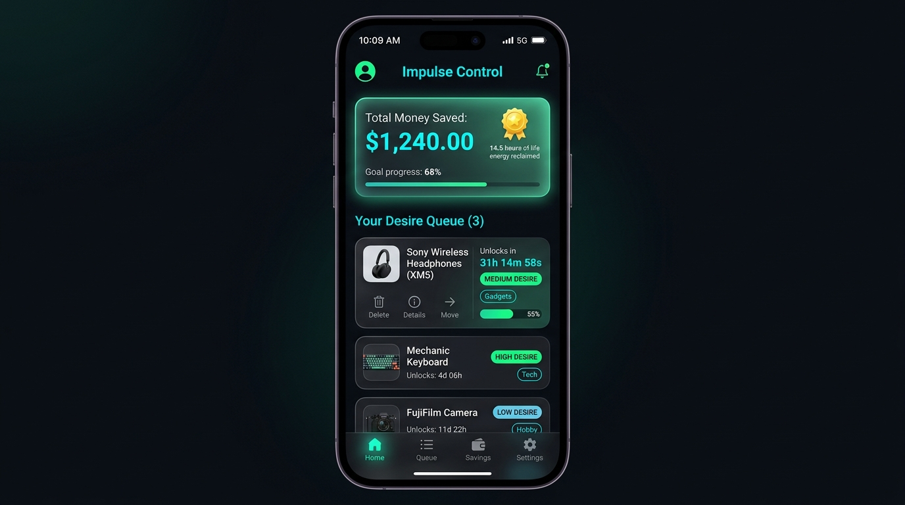
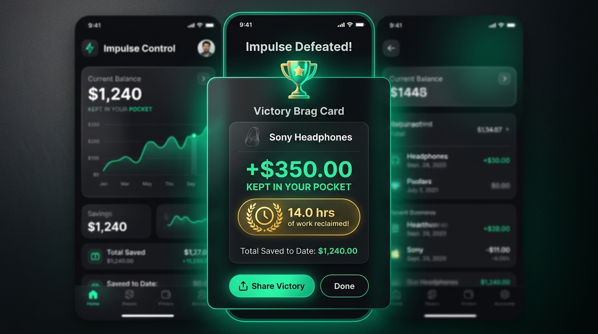

# 🔒 Impulse Control

> **Stop the 1-click economy. Every purchase you want enters a mandatory cooling-off queue.**

A psychological, friction-based financial wellness app built with Flutter. Rather than passively logging expenses after your money is already spent, **Impulse Control** intercepts impulse buying *before* it happens with an adaptive cooling-off queue, life energy translation, and AI reality checks.

<p align="center">
  
  
</p>

---

## ✨ Flagship Features (2026 Edition)

### 🧠 The Anti-Impulse Engine
- **Adaptive Cooling Queue** — Dynamic timers (24h, 48h, 72h, or 7 Days) automatically scaled to the purchase price to let dopamine subside.
- **⚡ Life Energy Calculator** — Enter your hourly wage once; every item instantly translates into the exact hours or workdays of your life needed to pay for it.
- **📈 20-Year Opportunity Cost** — Live projection of what that money would grow into at an 8% index return (e.g., "$150 today = $699 in 20 yrs").
- **🛡️ 15-Second Reality Check** — Before locking an item, an interactive interrogation challenges you: *Will you care in 3 months? Do you already own something similar?*
- **✨ AI Devil's Advocate** — Optional Groq (LLaMA 3.1) or Google Gemini integration for instant, witty roasts and reality checks. Works **100% offline** with built-in heuristic templates if no API key is provided.
- **🔗 Smart Store Link Scanner** — One-tap "Paste Store Link 🔗" automatically extracts product title, price, and hero image from web store links (Amazon, Shopify, etc.).
- **🏆 Victory & Brag Cards** — Whenever you pass on a purchase, celebrate with a sleek shareable card showing dollars and work hours saved.
- **📊 Anti-Impulse Insights** — Deep-dive analytics into your Pass Rate %, trigger categories, and long-term compounded wealth forecast.

### 🎨 Premium UI/UX
- **Category System** — Tag items with icons (💻 Tech, 👕 Fashion, 🎧 Gadgets, 🎮 Gaming, 🍔 Dining, 📚 Books).
- **Cooling Progress Indicator** — Visual progress bars on each card tracking elapsed cooling time.
- **Tap-to-View & Safe Editing** — Tap any item to inspect full opportunity breakdown, notes, and edit cosmetic details while protecting lock timers from impulsive cheating.
- **Hero Image Cards** — Paste an image URL to render rich dynamic backgrounds with gradient overlays.
- **Desire Level Badges** — Rate impulse urgency Low / Medium / High with reactive color-coded borders.
- **Dark Mode & Light Mode** — Seamless toggle between sleek dark neon aesthetic and clean professional light mode.

### 🌍 Global Ready & 100% Private
- **Zero Server Costs & Local-First** — Your financial data stays entirely on your device. Zero servers to maintain, zero privacy tracking.
- **Dynamic Currency Picker** — Searchable offline database with 150+ global currencies (NGN ₦, EUR €, GBP £, USD $, and more).
- **Persistent Preferences** — Themes, hourly wage, currency, and AI keys are remembered across sessions.

### 🔔 Smart Notifications *(Android & iOS)*
- **Halfway Reminder** — "Halfway through your cooling period! Still thinking about it?"
- **1-Hour Warning** — "Almost time to decide."
- **Unlock Alert** — "Your item is ready! Buy it or pass and save?"
- Notifications automatically cancel when you decide early.

---

## 📸 Tech Stack

| Layer | Technology |
|---|---|
| Framework | Flutter 3.x (Web, Android, iOS, Desktop) |
| Language | Dart |
| State Management | Provider (`ChangeNotifier`) |
| Local Storage | `shared_preferences` (Offline-first, 100% private) |
| Notifications | `flutter_local_notifications` + `timezone` |
| AI Integration | Groq API (LLaMA 3.1) / Google Gemini 1.5 Flash / Offline Heuristics |
| Link Parsing | `http` (OpenGraph & Meta parsing) |
| Currency Data | `currency_picker` (150+ offline currencies) |
| ID Generation | `uuid` |

---

## 🚀 Getting Started

### Prerequisites
- Flutter SDK (`^3.9.0`)
- Dart SDK (`^3.9.0`)
- A connected device, emulator, or Chrome browser

### Installation

```bash
# Clone the repository
git clone https://github.com/BErukky/smart_expense_tracker.git

# Navigate into the project
cd smart_expense_tracker

# Install dependencies
flutter pub get

# Run the app (Chrome for web, or connect a device)
flutter run -d chrome
```

> **Windows Users**: Ensure **Developer Mode** is enabled in Settings → System → Developer Settings before running `flutter pub get`.

---

## 🗂️ Project Structure

```
lib/
├── main.dart                  # App entry point, theme engine
├── settings_provider.dart     # Global state: theme, currency, wage & AI key
├── models/
│   └── wish_item.dart         # WishItem data model (with duration & life energy)
├── screens/
│   ├── welcome_screen.dart    # Animated onboarding & currency picker
│   ├── home_screen.dart       # Main dashboard, cooling queue & insights
│   ├── add_wish_screen.dart   # Add item form with live cost calculator & link scanner
│   └── analytics_screen.dart  # Anti-impulse insights, pass rate & wealth forecast
├── widgets/
│   ├── wish_tile.dart         # Rich card with progress bar & live countdown
│   ├── item_detail_sheet.dart # Tap-to-view detail & safe edit modal
│   ├── reality_check_dialog.dart # 15-second interrogation & AI roast
│   ├── victory_card_dialog.dart  # Celebration brag card & clipboard share
│   └── settings_dialog.dart   # Hourly wage, currency & AI key preferences
├── utils/
│   └── cost_calculator.dart   # Life Energy & compound interest calculations
└── services/
    ├── notification_service.dart # Local notification scheduling
    ├── ai_service.dart           # Groq & Gemini AI integration
    └── url_scraper_service.dart  # Smart store link metadata extractor
```

---

## 🗺️ Roadmap

- [x] Adaptive cooling periods (24h to 7 days)
- [x] Life Energy / hourly wage converter
- [x] 20-Year compound interest opportunity cost
- [x] Reality check interrogation & AI Devil's Advocate
- [x] Smart product link scraper
- [x] Victory / brag cards with clipboard sharing
- [x] Anti-impulse analytics & insights screen
- [x] Tap-to-view item details with safe editing
- [ ] Home screen widget (Android / iOS)
- [ ] Optional Firebase Cloud Backup (optional sync across devices)

---

## 📄 License

This project is open source and available under the [MIT License](LICENSE).

---

**Made with ❤️ using Flutter** — *Because your wallet deserves a bodyguard.*